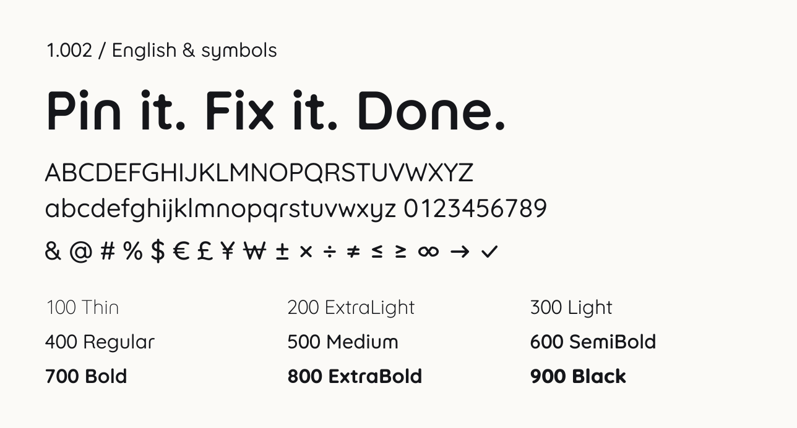

<p align="center">
  <picture>
    <source media="(prefers-color-scheme: dark)" srcset="docs/assets/brand/wordmark-dark.svg">
    
  </picture>
</p>

<h1 align="center">Limn Sans</h1>

<p align="center">A rounded sans for English and symbols. Nine static weights. SIL OFL 1.1.</p>

<p align="center">
  
</p>

Limn Sans is the typeface of limn. It builds on Quicksand with rounded strokes,
pin-shaped dots and a shoulderless n family. **Version 1.002 is the stable release for English
and supported symbols**, in nine static weights from Thin 100 to Black 900.

## Download and install

[Download LimnSans-1.002.zip](https://github.com/dartworklabs/limn-sans/releases/download/v1.002/LimnSans-1.002.zip)
· [Release notes and checksums](https://github.com/dartworklabs/limn-sans/releases/tag/v1.002)

1. Download and extract the release ZIP. Check it against the release's `SHA256SUMS`;
   the package also contains checksums for its individual files.
2. For desktop use, install the nine `.ttf` files with your operating system's font
   installer. Choose **Limn Sans** in your application.
3. For the web, keep `fonts.css` and the nine `.woff2` files together, then link the CSS.

```html
<link rel="stylesheet" href="fonts/fonts.css">
```

```css
body { font-family: "Limn Sans", sans-serif; }
.numbers { font-variant-numeric: proportional-nums; }
.alternates { font-feature-settings: "ss01" 1, "zero" 1; }
```

Use the release package for installation. The repository's default build and its
site previews are development tools. See the [installation guide](docs/release-install.md)
for package details.

## Release coverage and features

| Item | Version 1.002 |
| --- | --- |
| Coverage | 919 Unicode codepoints; 933 glyphs per face, including unencoded alternates |
| Weights | Nine static faces: Thin 100, ExtraLight 200, Light 300, Regular 400, Medium 500, SemiBold 600, Bold 700, ExtraBold 800, Black 900 |
| Files | Nine hinted TTFs and nine whole WOFF2s, plus CSS, manifests, installation instructions, OFL notices and checksums |
| Quality scope | English and supported symbols. Greek and extended Latin remain for compatibility, without language QA |
| OpenType | `kern`; default tabular figures with `pnum` and `tnum`; `ss01` for double-storey a/g; `zero` for dotted zero; `ccmp`, `mark` and `mkmk` for combining attachment and contextual i/j dots |
| Exclusions | All Hangul syllables, jamo and Hangul marks; the pinned logo glyph. No core/ext split or variable font |

The package's `fonts.json` is the exact codepoint inventory; `fonts.css` declares
that coverage so unsupported characters use the site's fallback font. U+3000
IDEOGRAPHIC SPACE is retained with an advance of 819 font units at every weight.
Coverage does not imply that every language using an included character has been
proofread; language coverage work is tracked separately and no language beyond
English has been signed off.

Known limitation: the alphabetic subscript **ₑ** has an unchanged ink-area decrease
of about **1.06% from weight 800 to 900**. It remains an informational finding.

Version 1.002 corrects licence metadata and adds one codepoint. The `name` table
copyright string no longer declares a Reserved Font Name of its own and now fits
the 500-character nameID 0 limit that external distribution channels enforce. The
added codepoint is U+25CC DOTTED CIRCLE, the placeholder a shaper draws under a
combining mark typed without a base, which fell back to `.notdef` while the glyph
was missing. `post.underlineThickness` is now one family value, the Regular's 61,
instead of 0.8 of each weight's own stem; browsers use it only under
`text-decoration-thickness: from-font`. Every other glyph's outlines, metrics,
kerning and hints are identical to 1.001.

Version 1.001 fixed Safari/CoreText spacing for surviving combining sequences
(such as `x` + grave) and replaced i/j dots before above marks, including
below-accented i contexts. See the [attachment correction and validation](docs/combining-attachment.md).

Synthetic deep or mixed attached/free mark stacks can differ between engines.
Positioned accents can exceed the fixed 970/−330 line box and clip in constrained
containers. Greek and extended Latin have no language QA; Windows is deferred,
and physical mobile/iOS and persistent Font Book/Office installation are untested.
Versions 1.000 and 1.001 were built before this repository was published and are
not distributed here; both are superseded by 1.002, and 1.000 additionally has the
combining-sequence spacing defect. Their manifests remain immutable, and 1.002's
provenance records what it inherits from them.

## Development and specimens

The default bilingual `full` profile remains **0.100**, with experimental Hangul
and core/ext web subsets. It is not qualified for public release. The engine and
brand previews can show research features, coloured pins and trademark artwork
that are absent from 1.002.

- [Development and research guide](docs/development.md): retained construction rules,
  build commands, full-profile checks and source map.
- [Release profile](docs/release-profile.md): isolated 1.002 inputs, packaging and validation.
- [README artwork provenance](docs/assets/README.md): actual release fonts and hashes.
- [Design system portfolio on Figma](https://www.figma.com/design/zq6DnehToUVoBzckv929Lv).

## License

The fonts and font data use the [SIL Open Font License 1.1](OFL.txt). Limn Sans
declares **no Reserved Font Name of its own**, which keeps it compatible with
external distribution channels. The Latin is derived from Quicksand (© The
Quicksand Project Authors); supplemental symbols are derived in part from
NanumSquareRound (© NAVER Corporation). Both upstream OFL notices remain required
even though the release excludes Hangul, and the inherited reserved font names —
"Quicksand" and NAVER's Nanum names — still bind. Keep `OFL.txt`,
`OFL-Quicksand.txt` and `OFL-NanumSquareRound.txt` with redistributed packages,
and follow their reserved name conditions.

The limn name, logo and wordmark are Dartwork trademarks outside the font's OFL.
The [README wordmarks](docs/assets/README.md) are preserved brand exports, separate
from the release specimen and font files.
